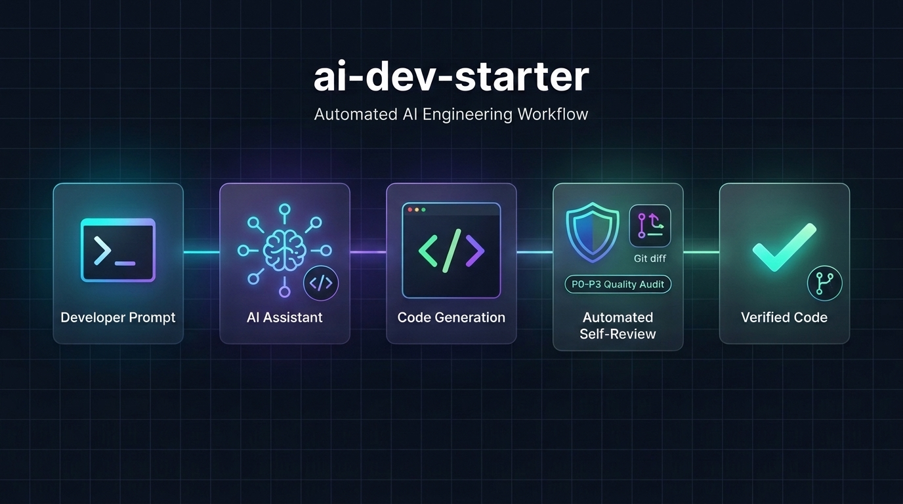
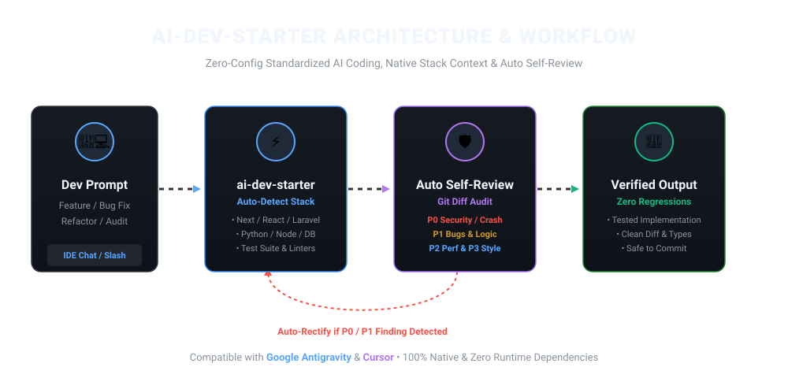

<div align="center">



# 🚀 ai-dev-starter

**Zero-config AI development starter kit & automated self-review engine for Google Antigravity & Cursor.**

[](https://www.npmjs.com/package/ai-dev-starter)
[](LICENSE)
[](#architecture)
[](https://nodejs.org)
[](CONTRIBUTING.md)

<p align="center">
  <a href="#-quick-start">Quick Start</a> •
  <a href="#-why-ai-dev-starter">Why This Exists</a> •
  <a href="#-how-it-works">How It Works</a> •
  <a href="#-the-8-engineering-workflows">8 Core Workflows</a> •
  <a href="#-automated-post-implementation-review">Auto Self-Review</a> •
  <a href="#-cli-commands">CLI Tools</a>
</p>

</div>

---

## ⚡ Quick Start

Run this single command inside the root of any repository (no install needed):

```bash
npx ai-dev-starter
```

That's it! The interactive CLI launches, auto-detects your technology stack, installs native IDE rules, and configures everything in seconds.

```text
┌────────────────────────────────────────────────────────┐
│  🚀 AI Development Starter Kit (v1.0.1)                │
│  Universal AI Engineering & Quality Automation         │
└────────────────────────────────────────────────────────┘

🔍 Scanning repository architecture...
  ✔ Primary Stack Detected: Next.js (App Router) + TypeScript
  ✔ Styling System: Tailwind CSS
  ✔ Testing Setup: Vitest
  ✔ Configured Target IDE: Google Antigravity & Cursor

✨ Installation complete! Your AI assistant is now supercharged.
```

---

## 💡 Why `ai-dev-starter`?

### The Problem: *“The Intern with Root Access”*
Most developers use AI coding assistants like raw interns:
- **Hallucinated assumptions:** The AI invents dependencies you don't use or forgets your existing database schema.
- **Hidden regressions & tech debt:** It changes code that works, introduces subtle type errors, and omits tests.
- **Disjointed context:** Every new prompt feels like starting from scratch because the AI doesn't know your repository's conventions.

### The Solution: A Production-Grade AI Engineering Pipeline
`ai-dev-starter` gives your IDE's native AI assistant a **Senior Staff Engineer & QA Lead mindset**:

1. **Native Stack Context:** Automatically feeds your frameworks, conventions, testing commands, and database ORM into the agent's memory.
2. **Standardized Workflows:** 8 specialized workflows for bug fixing, security audits, feature development, and refactoring.
3. **Automated Post-Implementation Review:** Every time the AI writes code, it stops and audits its own `git diff` against strict P0–P3 severity standards before delivering the final answer.
4. **100% Native & Free:** Zero external API keys. Zero cloud telemetry. Everything runs inside your IDE's native model.

---

## 🔄 How It Works

<div align="center">
  
</div>

### The Quality Feedback Loop
1. **Developer Prompt:** You ask the AI for a feature, bug fix, or refactor.
2. **Context Engine:** The AI pulls your repository's detected stack, conventions, and constraints from `.agents/project-context.md`.
3. **Implementation:** The AI edits or creates the necessary files following production standards.
4. **Auto-Review Audit:** If `auto_review_on_change: true`, the AI runs an internal `git diff` check on its own changes:
   - Checks for security flaws (OWASP), missing input sanitization, and crashes (**P0**)
   - Checks for logic bugs, null dereferences, and state mutations (**P1**)
   - Checks for N+1 queries, unindexed queries, and heavy re-renders (**P2**)
   - Checks for formatting, dead code, and naming standards (**P3**)
5. **Verified Delivery:** If any critical issue is caught, the AI rectifies it immediately. You only receive tested, production-grade code.

---

## 🛠️ The 8 Engineering Workflows

Speak naturally to your AI assistant. The skills and rules are auto-routed:

| Workflow | What It Does | Example Prompt |
| :--- | :--- | :--- |
| 🔍 **Code Review** | Evidence-based Git diff analysis with P0–P3 severity scoring | `"Review my recent git changes"` |
| 🐛 **Bug Fix** | Root-cause analysis, reproducible test, minimal fix proposal | `"Fix this 500 error: [paste trace]"` |
| 🚀 **Feature Development** | Requirements-first planning, step-by-step implementation | `"Implement password reset via email"` |
| ♻️ **Refactor** | Behavioral preservation with test coverage verification | `"Refactor OrderService to reduce cyclomatic complexity"` |
| 🛡️ **Security Audit** | OWASP Top 10 inspection: injections, auth bypass, CSRF, IDOR | `"Run a security audit on the auth module"` |
| ⚡ **Performance Audit** | N+1 queries, unindexed lookups, bundle bloat, blocking I/O | `"Audit the performance of our API endpoints"` |
| 🏗️ **Architecture Review** | Layer boundaries, dependency direction, coupling & cohesion | `"Review the folder architecture of our project"` |
| 🧪 **Test Generation** | Native tests matching your runner (Vitest, Jest, PHPUnit, Pytest) | `"Write unit & integration tests for UserService"` |

---

## 🔍 Feature Spotlight: Automated Self-Review

When enabled in `.agents/project-context.md`:
```yaml
auto_review_on_change: true
report_language: "fa" # "fa" for Persian, "en" for English
```

Whenever the AI writes or modifies code in your project, it appends a structured self-audit report directly in chat:

```markdown
### 🛡️ Post-Implementation Self-Review

| Severity | File & Location | Finding | Status |
|:---|:---|:---|:---|
| **P0** (Security) | `api/checkout.ts#L42` | Missing amount validation allowed negative values | ✅ Fixed in diff |
| **P1** (Bug) | `hooks/useCart.ts#L18` | Potential undefined access on empty cart state | ✅ Guard added |
| **P2** (Perf) | `db/queries.ts#L88` | Eager loading applied to prevent N+1 query | ✅ Optimized |

> **Audit Summary:** All automated checks passed. 0 open P0/P1 issues remaining.
```

---

## 🌐 Supported Stacks (Auto-Detected)

`ai-dev-starter` features a zero-dependency heuristic detector that identifies your stack out of the box:

- **Frontend:** Next.js (App & Pages Router), React, Vue, Nuxt, Svelte, Angular, Vite
- **Backend:** Laravel, Node.js (Express, Fastify, NestJS), Python (FastAPI, Django, Flask), Go
- **Styling:** Tailwind CSS, CSS Modules, Styled Components, Sass
- **Databases & ORMs:** PostgreSQL, MySQL, SQLite, MongoDB, Prisma, Drizzle, Eloquent, SQLAlchemy, TypeORM
- **Test Runners:** Vitest, Jest, Playwright, Cypress, PHPUnit, Pest, Pytest

---

## 💻 CLI Commands Reference

You don't need to install anything globally. Run via `npx`:

```bash
# 1. Interactive Setup (with visual box-drawing UI)
npx ai-dev-starter

# 2. Inspect Stack Detection (dry-run without modifying files)
npx ai-dev-starter detect

# 3. Health Check (verifies file integrity and tracks custom changes)
npx ai-dev-starter doctor

# 4. Safe Upgrade (updates starter kit rules without overwriting your customizations)
npx ai-dev-starter update

# 5. Clean Uninstall (removes tracked files, leaves your code untouched)
npx ai-dev-starter uninstall
```

### CLI Flags for CI / Automation

```bash
npx ai-dev-starter init --ide antigravity --lang en --target ./my-app
npx ai-dev-starter init --ide cursor --merge --target ./my-app
npx ai-dev-starter init --ide both --skills code-review,bug-fix,security-audit
```

---

## ⚙️ Configuration File (`project-context.md`)

After initialization, your project will have a `.agents/project-context.md` file. You can customize your project constraints:

```yaml
---
project_name: "My App"
backend_framework: "nextjs"
backend_language: "typescript"
frontend_framework: "react"
styling: "tailwind"
databases:
  - type: "postgresql"
    orm: "prisma"
test_runner: "vitest"
test_command: "npm test"
auto_review_on_change: true
report_language: "fa" # "fa" (Persian) or "en" (English)
---
```

---

## 📂 Architecture & Directory Structure

```text
ai-dev-starter/
├── assets/                       # Diagrams, banners, and visual media
│   ├── hero-banner.jpg
│   └── architecture-diagram.svg
├── core/                         # Universal, IDE-agnostic quality guidelines
│   ├── agent-principles.md       # Identity, safety rules, evidence-based reasoning
│   ├── git-analysis.md           # Diff parsing & staging guidelines
│   ├── review-methodology.md     # Inspection checklists & heuristics
│   ├── safety-policy.md          # Guardrails for destructive actions
│   └── severity-levels.md        # P0, P1, P2, P3 definitions with code examples
├── workflows/                    # Step-by-step task execution blueprints
│   ├── code-review.md
│   ├── bug-fix.md
│   ├── feature-development.md
│   ├── refactor.md
│   ├── security-audit.md
│   ├── performance-audit.md
│   ├── architecture-review.md
│   └── test-generation.md
├── standards/                    # Cross-language engineering standards
│   ├── backend.md
│   ├── frontend.md
│   ├── database.md
│   ├── security.md
│   └── testing.md
├── adapters/
│   ├── antigravity/              # Google Antigravity (AGENTS.md + native skills)
│   └── cursor/                   # Cursor rules (.cursor/rules/*.mdc)
├── scripts/
│   ├── ai-dev-starter.js         # Interactive installer & CLI engine
│   └── detector.js               # Heuristic framework & tool detector
└── tests/
    └── test-installer.js         # Automated regression test suite (55 tests)
```

---

## 🤝 Contributing

Contributions are very welcome! To contribute:

1. Fork the repository
2. Clone your fork: `git clone https://github.com/your-username/ai-dev-starter.git`
3. Run tests to make sure everything passes: `npm test`
4. Create a feature branch: `git checkout -b feature/my-new-workflow`
5. Commit your changes: `git commit -m 'Add support for Windsurf adapter'`
6. Push to your branch and submit a Pull Request!

---

## 📜 License

Distributed under the **MIT License**. See [LICENSE](./LICENSE) for details.

---

<div align="center">
  <sub>Built with ❤️ for developers who love clean code and reliable AI assistants.</sub>
</div>
